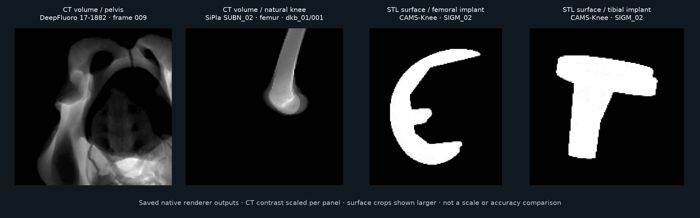

# pytorch3d-drr

**Differentiable CT projections and STL silhouettes with a shared PyTorch scene/camera API.**

[Install](#install) · [Quick start](#quick-start) · [Geometry](docs/geometry.md) · [Agent guide](AGENTS.md)



*Saved native outputs: DeepFluoro pelvis, SiPla natural-knee femur and CAMS-Knee
implants. Renderings only; no input radiographs or manuscript figures.
Contrast and crop differ across panels. [Provenance](docs/assets/README.md).*

| Renderer | Output |
|---|---|
| CT / `CTRenderer`, linear | Sampled density path integral |
| CT / `CTRenderer`, exp | `1 - exp(-0.0192 * integral)`, not transmitted intensity |
| STL / `STLRenderer` | Soft alpha silhouette, not mesh X-ray attenuation |

Research preview, not a clinical device or an official PyTorch3D release.
The full pose-refiner, NFD initializer and optimizer adapters are **not packaged**.

## Install

Requires Python ≥3.10, PyTorch ≥2.1 and **compiled PyTorch3D**, plus NumPy,
nibabel and numpy-stl. Local CPU checks use Python 3.11 / torch 2.5.1 /
PyTorch3D 0.7.9. CPU works for the small demo; CUDA needs matching builds.

Install [PyTorch3D](https://github.com/facebookresearch/pytorch3d/blob/main/INSTALL.md)
first, then:

```sh
git clone https://github.com/wjh19990923/pytorch3d-drr.git
cd pytorch3d-drr
python -m pip install -e ".[examples]"
```

[Full Ubuntu CPU recipe, CUDA/Windows notes and troubleshooting](docs/usage.md#installation).
These are observed configurations, not an all-platform support guarantee.

## Quick start

No dataset or network access is needed at runtime:

```sh
python -m pytorch3d_drr doctor --json --device cpu
python -m pytorch3d_drr demo --device cpu --output outputs/demo
```

Expect `"ok": true`, `"actual_device": "cpu"`, three `(1,32,32)` arrays,
previews and `report.json`. The cube is an installation self-test.
Compare raw `.npy` arrays, not independently normalized previews.

## Python example

Small CPU example; its synthetic geometry is unrelated to the gallery.

```python
import torch
from pytorch3d_drr import (
    AnatomyCT, Camera, CubeCT, CubeSTL, CTRenderer, STLRenderer, Scene,
)

def project(anatomy, renderer, **options):
    scene = Scene()
    scene.add_anatomies(anatomy)
    scene.add_cameras(Camera(
        "demo", (0, 0, 400), (0, 0, -1), (0, 1, 0),
        160., 160., 0., 0., 400.,
    ))  # detector at z=400 mm; source at the origin
    renderer.bind_scene(scene)
    return renderer.render(width_pixels_num=32, height_pixels_num=32,
                           scale_output=False, **options)

with torch.no_grad():  # Remove for an autograd-based application.
    density, affine = CubeCT.create_voxel_grid(
        40, 30, 20, (16, 16, 16), (0, 0, 200), 1.,
    )
    volume = AnatomyCT("phantom", density, affine)
    linear = project(volume, CTRenderer(device="cpu"),
                     binary=False, efficient=False, decay_type="linear")
    exp = project(volume, CTRenderer(device="cpu"),
                  binary=False, efficient=False, decay_type="exp")
    silhouette = project(
        CubeSTL(width=40, height=30, depth=20, center_pose=(0, 0, 200)),
        STLRenderer(device="cpu"),
    )
print(linear.shape, exp.shape, silhouette.shape)  # each: (1,32,32)
```

## Real inputs and refinement

- [STL + calibration/pose JSON](examples/surface_implant.py)
- [DeepFluoro CT + specimen/frame](examples/volume_deepfluoro.py)
- [Input formats and commands](examples/README.md)
- [Geometry contract](docs/geometry.md): millimetres, column-vector model-to-world
  matrices, volume `(B,1,D,H,W)`, image `(B,H,W)`.

Connect the projection tensor to your loss and optimizer. Supply your own pose
parameterization and rotation centre. Historical gallery outputs do not certify
alignment parity of the packaged real-data adapters.

## For agents and contributors

Start with [AGENTS.md](AGENTS.md), then [geometry](docs/geometry.md).
Implementation: [package entry point](src/pytorch3d_drr/__init__.py).
[Contribution guide](CONTRIBUTING.md) · [CPU CI](.github/workflows/cpu.yml).

```sh
python -m unittest discover -s tests -v
python tools/check_readme.py
python tools/check_candidate.py
```

CLI stdout is JSON; diagnostics go to stderr. Exit codes: **0** success,
**1** runtime/diagnostic failure, **2** invalid arguments. Check `ok`,
`actual_device` and files. Explicit CUDA requests fail rather than silently
falling back. `doctor` checks the environment; `demo` tests rendering.

## License and data

[MIT](LICENSE) for original code; [BSD attribution](THIRD_PARTY_NOTICES.md) for
upstream portions. Source CTs, radiographs and implant meshes are not bundled.
Dataset/CAD rights remain with their owners. Rendered examples are not
registration-accuracy evidence. [Scope and limitations](docs/usage.md#scope-and-limitations).
