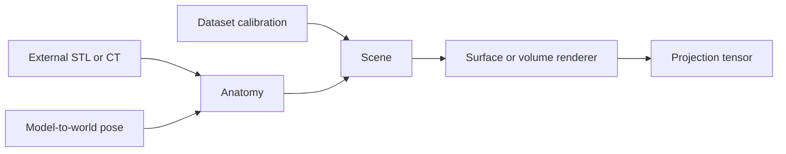

# pytorch3d-drr

**Early research preview — API and examples are still being validated.**
This is an independent project, not an official PyTorch3D release.

The package extracts the existing renderer implementation:

- `STLRenderer`: differentiable soft surface silhouettes, not mesh-based X-ray attenuation.
- `CTRenderer`: volumetric DRRs with `linear` and `exp` output.
  Linear returns the sampled density path integral. Exp returns
  `1 - exp(-0.0192 * integral)`, not transmitted intensity.
- `Camera`, `Scene`, `AnatomySTL`, `AnatomyCT`: existing geometry API.

No medical images, implant meshes, credentials, checkpoints or experiment logs
are included. Original contributions use the [MIT license](LICENSE);
upstream portions retain their [BSD terms and attribution](THIRD_PARTY_NOTICES.md).

## Installation

Use a dedicated environment. First install a mutually compatible PyTorch,
torchvision, CUDA toolkit (for GPU), and PyTorch3D build following
[PyTorch3D installation instructions](https://github.com/facebookresearch/pytorch3d/blob/main/INSTALL.md).
PyTorch3D has compiled extensions; a plain torch installation is insufficient.

The existing development environment has Python 3.11, torch 2.5.1 and
PyTorch3D 0.7.9. This is an observed environment, not a tested clean-install matrix.
Do not assume every CUDA or operating-system combination works.

From this directory:

```sh
python -m pip install -e ".[examples]"
python -c "from pytorch3d_drr import CTRenderer, STLRenderer"
python -m unittest discover -s tests -v
```

## Examples and data

### First run: no dataset required

After installation:

```sh
python -m pytorch3d_drr doctor --json --device cpu
python -m pytorch3d_drr demo --device cpu --output outputs/demo
```

The demo generates a small volume and cube mesh locally, then renders linear,
exp and surface outputs using the native renderers. It writes raw `.npy`
arrays, normalized `.pgm` previews and `report.json`. No network access or
medical files are needed at runtime. The installed `pytorch3d-drr` command
is equivalent to `python -m pytorch3d_drr`.

Both commands emit JSON on stdout and return a nonzero exit code on failure.
Diagnostic success does not guarantee rendering success: run both commands.
Explicit `--device cuda` fails if CUDA is unavailable; `--device auto` permits
automatic selection. CPU is the CLI default.

Read the [geometry contract](docs/geometry.md), [agent guide](AGENTS.md), and
[contribution/test guide](CONTRIBUTING.md). CI tests CPU only.

### Real data

See [examples](examples/README.md). Supply data acquired under the respective
dataset terms. Dataset accessibility does not grant redistribution permission.
Examples default to CPU; request `--device cuda` explicitly.

All distances are millimetres. Model matrices are column-vector homogeneous
model-to-world transforms. Camera normals, vertical axes, detector dimensions,
principal offsets and source-detector distance must match the dataset.
Do not reuse an arbitrary example camera for quantitative evaluation.



## Scope and limitations

The extracted core is not yet a stable API. The GUI pose-refiner application,
its optimizer adapters and dataset-specific experimental workflows are not
included in this first candidate. No equivalence to those complete experiments
is claimed. Their extraction and parity tests remain pending.

Depth sampling now preserves gradients through depth bounds, matching the
repair used in the experiments. Crop/raster visibility changes are not globally
smooth. Finite gradients alone do not prove registration accuracy.
This is research software, not a clinical device.
