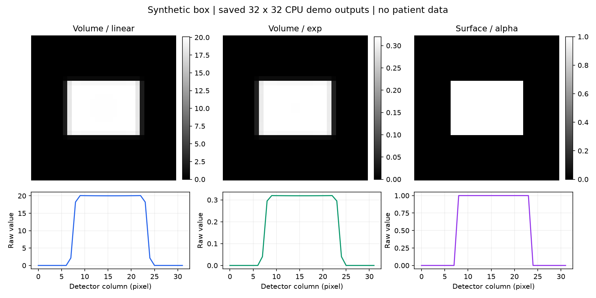
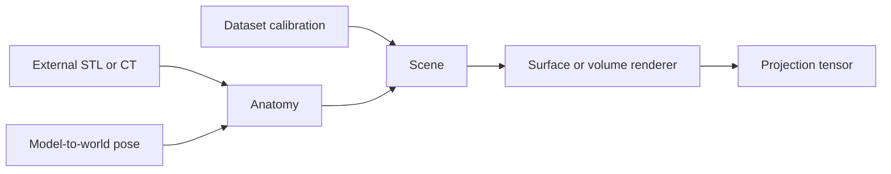

# Installation and usage guide

[Back to README](../README.md)

## Installation

### Environment and verification status

| Component | Requirement / observed configuration |
|---|---|
| Python | Metadata requires ≥3.10; local CPU checks use 3.11.15 |
| PyTorch | Metadata requires ≥2.1; local checks use 2.5.1 |
| PyTorch3D | Install separately, including compiled extensions; local checks use 0.7.9 |
| Core dependencies | NumPy, nibabel, numpy-stl; pip installs these |
| Example dependencies | h5py, matplotlib through `.[examples]` |
| CPU | Enough for the small offline demo; no GPU required |
| GPU | Optional NVIDIA CUDA device with compatible driver and PyTorch/PyTorch3D builds |
| OS | Local Windows CPU checks; Ubuntu 22.04 CPU CI recipe; not an all-platform support matrix |

The observed Windows environment has a CUDA 11.8 PyTorch build, but the README
checks use CPU. No universal GPU-memory minimum has been measured: memory depends
on image resolution, volume/mesh size and sampling settings.

Use a dedicated environment. First install a mutually compatible PyTorch,
torchvision, CUDA toolkit (for GPU), and PyTorch3D build following
[PyTorch3D installation instructions](https://github.com/facebookresearch/pytorch3d/blob/main/INSTALL.md).
PyTorch3D has compiled extensions; a plain torch installation is insufficient.

The existing development environment has Python 3.11, torch 2.5.1 and
PyTorch3D 0.7.9. This is an observed environment, not a tested clean-install matrix.
Do not assume every CUDA or operating-system combination works.

From this directory:

```sh
python -m pip install -e ".[examples]"
python -c "from pytorch3d_drr import CTRenderer, STLRenderer"
python -m unittest discover -s tests -v
```

### Fresh Ubuntu CPU environment

The following matches the dependency choices in [CPU CI](../.github/workflows/cpu.yml).
It is a recipe, not a claim that every clean installation has been tested.
First install Git, a C++ compiler and Python headers (Ubuntu packages `git`,
`build-essential`, `python3-dev`). Then:

```sh
conda create -n pytorch3d-drr python=3.11 -y
conda activate pytorch3d-drr
python -m pip install --upgrade pip "setuptools>=77" wheel ninja
python -m pip install torch==2.5.1 torchvision==0.20.1 --index-url https://download.pytorch.org/whl/cpu
python -m pip install iopath
python -m pip install --no-build-isolation "git+https://github.com/facebookresearch/pytorch3d.git@v0.7.9"
git clone https://github.com/wjh19990923/pytorch3d-drr.git
cd pytorch3d-drr
python -m pip install -e ".[examples]"
python -m pytorch3d_drr doctor --json --device cpu
python -m pytorch3d_drr demo --device cpu --output outputs/demo
```

### CUDA and other platforms

For CUDA, use a compatible GPU build from the [PyTorch installer](https://pytorch.org/get-started/locally/)
instead of the CPU wheel above, then install/build PyTorch3D for that same
environment. Source builds need a compatible CUDA toolkit and compiler.
`torch.cuda.is_available()` alone does not prove that PyTorch3D has CUDA kernels.
Rebuild compatible extensions after changing the PyTorch version.

Follow the [official PyTorch3D platform instructions](https://github.com/facebookresearch/pytorch3d/blob/main/INSTALL.md).
Windows builds can need Visual Studio C++ tools and version-specific steps;
this project does not ship a Windows wheel or a one-click CUDA installer.
macOS and MPS have not been validated here. Do not infer support from CPU CI.

## Examples and data

### First run: no dataset required



The simple box is an installation self-test, not the main application example.
It needs no external dataset. The real-data gallery above comes from historical
research outputs, not a fresh run of the packaged adapters.

After installation:

```sh
python -m pytorch3d_drr doctor --json --device cpu
python -m pytorch3d_drr demo --device cpu --output outputs/demo
```

Expect `"ok": true`, `"actual_device": "cpu"`, and three `(1,32,32)` arrays.
Inspect raw `.npy` values when comparing linear and exp: their `.pgm` previews
are normalized independently and can look alike despite different scales.

With a working CUDA-enabled environment:

```sh
python -m pytorch3d_drr doctor --json --device cuda
python -m pytorch3d_drr demo --device cuda --resolution 64 --output outputs/demo-cuda
```

The demo generates a small volume and cube mesh locally, then renders linear,
exp and surface outputs using the native renderers. It writes raw `.npy`
arrays, normalized `.pgm` previews and `report.json`. No network access or
medical files are needed at runtime. The installed `pytorch3d-drr` command
is equivalent to `python -m pytorch3d_drr`.

Both commands emit JSON on stdout and return a nonzero exit code on failure.
Diagnostic success does not guarantee rendering success: run both commands.
Explicit `--device cuda` fails if CUDA is unavailable; `--device auto` permits
automatic selection. CPU is the CLI default.

Read the [geometry contract](../docs/geometry.md), [agent guide](../AGENTS.md), and
[contribution/test guide](../CONTRIBUTING.md). CI tests CPU only.

### Real data

| Example | Inputs you provide |
|---|---|
| [Femoral implant surface](../examples/surface_implant.py) | Legally acquired STL and camera/pose JSON |
| [DeepFluoro pelvis volume](../examples/volume_deepfluoro.py) | HDF5 file, specimen ID and frame ID; linear or exp mode |

```sh
python examples/surface_implant.py --stl /path/femoral.stl --geometry /path/calibration.json --output outputs/surface.png --device cpu
python examples/volume_deepfluoro.py --data /path/ipcai_2020_full_res_data.h5 --specimen 17-1882 --frame 000 --mode linear --output outputs/linear.png --device cpu
python examples/volume_deepfluoro.py --data /path/ipcai_2020_full_res_data.h5 --specimen 17-1882 --frame 000 --mode exp --output outputs/exp.png --device cpu
```

Replace placeholder paths with your own files. These adapters have not yet
passed new packaged real-data alignment tests. Their presence does not imply
reproduction of the research pipeline. The historical real-data gallery shows
the original renderer's outputs; it does not validate these packaged adapters
or establish clinical accuracy.

See [examples](../examples/README.md). Supply data acquired under the respective
dataset terms. Dataset accessibility does not grant redistribution permission.
Examples default to CPU; request `--device cuda` explicitly.

All distances are millimetres. Model matrices are column-vector homogeneous
model-to-world transforms. Camera normals, vertical axes, detector dimensions,
principal offsets and source-detector distance must match the dataset.
Do not reuse an arbitrary example camera for quantitative evaluation.



## Python example

This no-data example uses the native API and the offline synthetic demo geometry:

```python
import torch
from pytorch3d_drr import (
    AnatomyCT, Camera, CubeCT, CubeSTL, CTRenderer, STLRenderer, Scene,
)

def project(anatomy, renderer, **options):
    scene = Scene()
    scene.add_anatomies(anatomy)
    scene.add_cameras(Camera(
        "demo", (0, 0, 400), (0, 0, -1), (0, 1, 0),
        160., 160., 0., 0., 400.,
    ))  # detector at z=400 mm; source at the origin
    renderer.bind_scene(scene)
    return renderer.render(width_pixels_num=32, height_pixels_num=32,
                           scale_output=False, **options)

with torch.no_grad():  # Remove for an autograd-based application.
    density, affine = CubeCT.create_voxel_grid(
        40, 30, 20, (16, 16, 16), (0, 0, 200), 1.,
    )
    volume = AnatomyCT("phantom", density, affine)
    linear = project(volume, CTRenderer(device="cpu"),
                     binary=False, efficient=False, decay_type="linear")
    exp = project(volume, CTRenderer(device="cpu"),
                  binary=False, efficient=False, decay_type="exp")
    silhouette = project(
        CubeSTL(width=40, height=30, depth=20, center_pose=(0, 0, 200)),
        STLRenderer(device="cpu"),
    )
print(linear.shape, exp.shape, silhouette.shape)  # each: (1,32,32)
```

Keep `scale_output=False` to preserve raw values. This small example uses
full-grid volume rendering (`efficient=False`), not a speed benchmark.
See [demo.py](../src/pytorch3d_drr/demo.py) for output saving and validation.

### Connecting to pose refinement

Render a projection, compute your similarity loss against a target, and optimize
your pose parameters through autograd. You must supply the optimizer and pose
parameterization: the renderer accepts model-to-world matrices, not degree/radian
Euler vectors. Rotations act about the model origin unless you explicitly
construct a centroid-based correction. Read [geometry.md](../docs/geometry.md).
The full GUI refiner, NFD initializer and optimizer adapters are not packaged;
we do not present an unimplemented `PoseRefiner` API as a working example.

## Troubleshooting and checks

```sh
python -m unittest discover -s tests -v
python tools/check_candidate.py
```

| Symptom | Check |
|---|---|
| `No module named pytorch3d_drr` | Activate the right environment; install `-e ".[examples]"` from the clone |
| Missing PyTorch3D or extension errors | Install compiled PyTorch3D compatible with your Python and PyTorch |
| CUDA requested but unavailable | Check driver and both PyTorch/PyTorch3D builds; request CPU explicitly if intended |
| Blank or mirrored projection | Verify source position, detector axes, pose, millimetres and field of view |
| Linear/exp previews look identical | Compare raw arrays, not independently normalized previews |

Exit codes:0 success,1 diagnostic/runtime failure,2 invalid CLI syntax.
Check `ok`, `actual_device` and output files. `doctor` checks imports/allocation;
`demo` checks actual rendering. Neither proves registration accuracy. See
[AGENTS.md](../AGENTS.md) for machine-readable workflows and
[CONTRIBUTING.md](../CONTRIBUTING.md) for contribution requirements.

## Scope and limitations

The extracted core is not yet a stable API. The GUI pose-refiner application,
its optimizer adapters and dataset-specific experimental workflows are not
included in this first candidate. No equivalence to those complete experiments
is claimed. Their extraction and parity tests remain pending.

Depth sampling now preserves gradients through depth bounds, matching the
repair used in the experiments. Crop/raster visibility changes are not globally
smooth. Finite gradients alone do not prove registration accuracy.
This is research software, not a clinical device.
